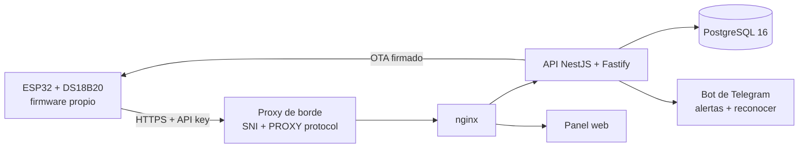

# ColdSense

**Monitoreo IoT de cámaras frigoríficas y heladeras comerciales: sensores ESP32, panel web, alertas por Telegram y actualizaciones OTA firmadas.**

> 🇬🇧 **English summary.** End-to-end IoT product for cold-chain monitoring in shops and restaurants.
> ESP32 + DS18B20 devices report temperature over HTTPS to a NestJS/Fastify API backed by PostgreSQL; a web
> panel shows live status, history and alerts; a Telegram bot notifies and lets staff acknowledge alerts.
> Firmware updates are delivered OTA and **signed with ECDSA P-256** (verified on the device, anti-downgrade).
> Running in production with a real sensor installed at a restaurant. Source code is private.

---

## El problema

Si una cámara de frío se corta de noche, el comercio se entera a la mañana con la mercadería perdida.
ColdSense mide la temperatura cada 30 segundos, avisa por Telegram apenas sale de rango o el sensor deja
de reportar, y guarda el histórico para controles de bromatología.

## Cómo funciona

### Dispositivo (firmware 2.x)
- Lectura DS18B20, reporte configurable (default 30 s) y **sync cada 10 s** con IP privada, MAC y estado.
- **Buffer offline en LittleFS**: si se cae el WiFi, las mediciones se guardan y se envían al volver.
- Watchdog, configuración en NVS, consola serie para configurar WiFi por USB.
- **OTA firmado con ECDSA P-256**: el equipo verifica la firma antes de instalar, rechaza firmas
  inválidas y versiones anteriores (anti-downgrade). Probado en hardware real.
- Rotación remota de API key y credenciales WiFi; métricas de recursos con alerta `LOW_MEMORY`.

### Backend
- **Ingesta autenticada por API key** (guardada como SHA-256), validación de que el serial coincida con la key,
  rate limit por dispositivo (429) y corrección de timestamps imposibles (NTP no sincronizado).
- **Multi-cliente:** clientes → sitios → dispositivos → sensores, con roles `SUPERADMIN`, `ADMIN_CLIENTE` y `VIEWER_CLIENTE`.
- **Reglas de alerta:** máximo, mínimo, "sin reportar" y `SENSOR_FAULT`, con ciclo disparada → reconocida → resuelta.
- **Bot de Telegram** con long polling: avisos, recordatorios, botón *Reconocer* y comandos `/estado` `/alertas`.
- Auth de usuarios con JWT (access 15 min + refresh 7 días).
- CLI de aprovisionamiento: crea cliente, sitio, dispositivo y reglas, y muestra la API key una sola vez.

### Panel
Estado en vivo por dispositivo, histórico y gráfico agregado, alertas, chequeo en vivo y reinicio remoto
del equipo, OTA inmediato.

## Seguridad

Dos auditorías propias, ambas aplicadas en producción:

- **AppSec** (OWASP): CSP, HSTS, rate limiting, migraciones versionadas, confianza correcta en el proxy para ver la IP real.
- **Dispositivo:** OTA firmado, anti-downgrade, borrado del binario al instalarse, rotación de secretos.
  Fase siguiente documentada: Secure Boot v2 + Flash Encryption.

## Calidad y operación

- **92 tests** (Jest) que corren contra un Postgres efímero.
- Deploy con imágenes `:pre-deploy` y script de rollback; backup diario con restauración probada.
- `install.sh` idempotente: genera secretos la primera vez, aplica migraciones y crea el superadmin.

## Mi rol

Hardware, firmware, backend, panel, infraestructura, seguridad e instalación en el cliente.

---

Código privado (producto comercial de Anhur Dynamics). Este repositorio documenta el producto y su arquitectura.
